# Automated ETL Data Pipeline with Docker & PostgreSQL

## Project Overview

This project demonstrates the development of an automated Extract, Transform, Load (ETL) pipeline using Python and PostgreSQL running inside a Docker container.

The pipeline processes a real-world online retail transaction dataset, performs data cleaning and validation, and loads the transformed records into a PostgreSQL database.

The project also implements scheduled execution using macOS `launchd` to reduce the need for manual processing.

## Dataset Source

**Dataset:** Online Retail  
**Provider:** UCI Machine Learning Repository  
**Source:** https://archive.ics.uci.edu/dataset/352/online+retail

The dataset contains transaction records from a UK-based online retailer between December 2010 and December 2011.

The original dataset was used to demonstrate data extraction, cleaning, transformation, and loading into PostgreSQL.

## Technologies Used

- **Python:** ETL pipeline development
- **Pandas:** Data cleaning, transformation, and validation
- **SQLAlchemy and Psycopg:** PostgreSQL database connectivity
- **PostgreSQL 17:** Relational database storage
- **Docker Desktop:** Database containerization
- **pgAdmin 4:** SQL queries and database validation
- **macOS launchd:** Scheduled pipeline execution
- **PyCharm:** Development environment
- **Git and GitHub:** Version control and documentation

## ETL Pipeline Architecture

```text
Online Retail CSV Dataset
          |
          v
     Python / Pandas
          |
          v
    Data Extraction
          |
          v
 Data Cleaning & Transformation
          |
          v
    Data Validation
          |
          v
 SQLAlchemy / Psycopg
          |
          v
 PostgreSQL 17 (Docker)
          |
          v
 SQL Validation (pgAdmin)
```

**Automation:** macOS `launchd` invokes `run_etl.sh`, which executes the Python ETL pipeline and records execution logs.

## 1. Docker Database Setup

PostgreSQL 17 was deployed in a Docker container named `etl-postgres`.

The database uses a persistent Docker volume and is accessible locally through port `5433`.

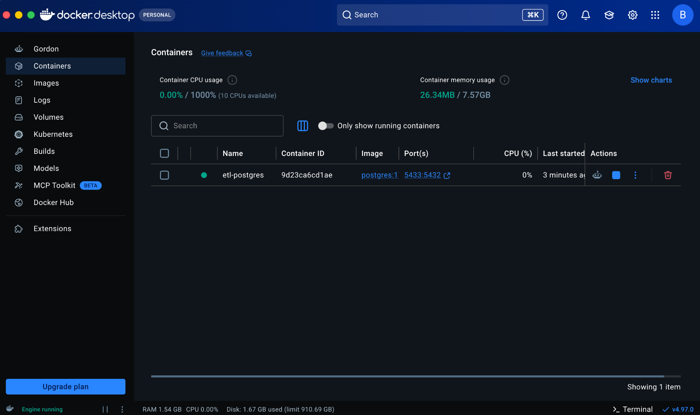

## 2. PostgreSQL Connection

The Docker-hosted PostgreSQL database was registered in pgAdmin 4.

- Database: `etl_project`
- Database server: PostgreSQL 17
- Host: `127.0.0.1`
- Port: `5433`

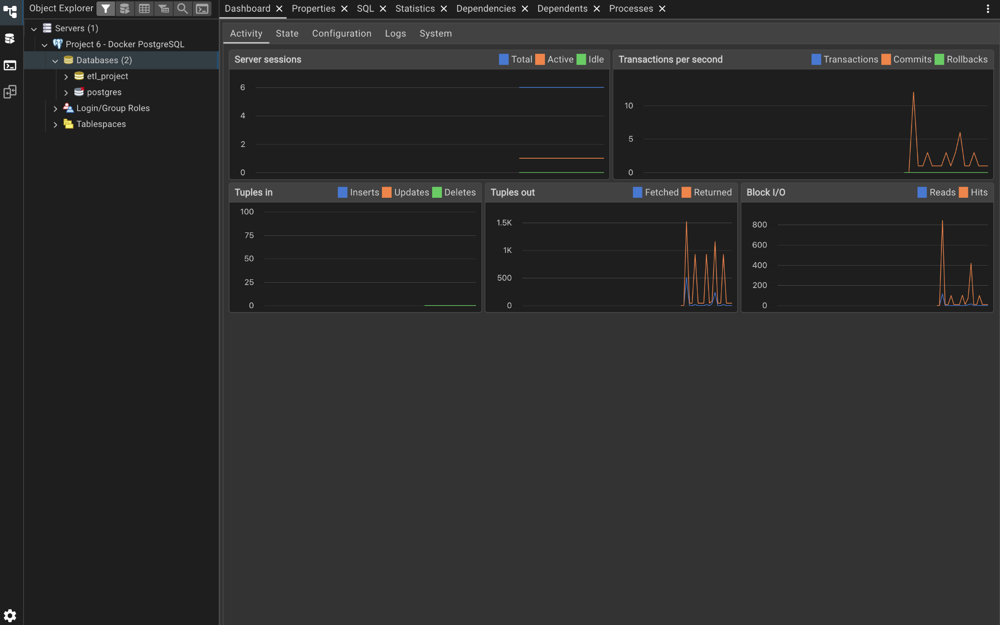

## 3. Data Extraction

The pipeline extracts transaction records from the Online Retail CSV dataset.

The source contains invoice details, product descriptions, quantities, prices, customer identifiers, and transaction dates.

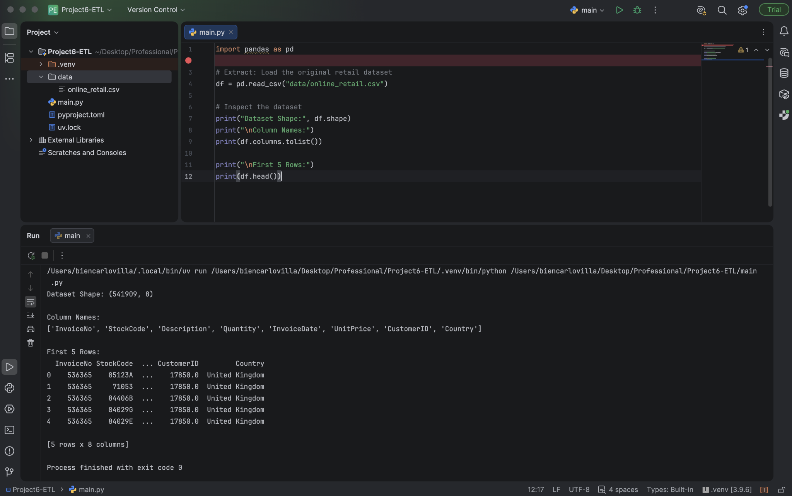

## 4. Data Cleaning and Transformation

Python and Pandas were used to prepare the dataset for database storage.

The transformation process includes:

- Converting invoice dates into datetime values
- Converting customer identifiers into nullable integer values
- Handling missing product descriptions
- Identifying missing customer identifiers
- Removing duplicate records
- Classifying transactions as sales or returns
- Calculating transaction amounts
- Checking zero or negative prices

### Data Quality Results

| Metric | Result |
|---|---:|
| Final transaction records | 536,641 |
| Missing descriptions before cleaning | 1,454 |
| Missing descriptions after cleaning | 0 |
| Invalid dates after conversion | 0 |
| Duplicate records after cleaning | 0 |
| Missing customer identifiers retained | 135,037 |
| Sales transactions | 526,054 |
| Return transactions | 10,587 |
| Zero or negative prices identified | 2,512 |

Missing customer identifiers were retained rather than inventing customer information.

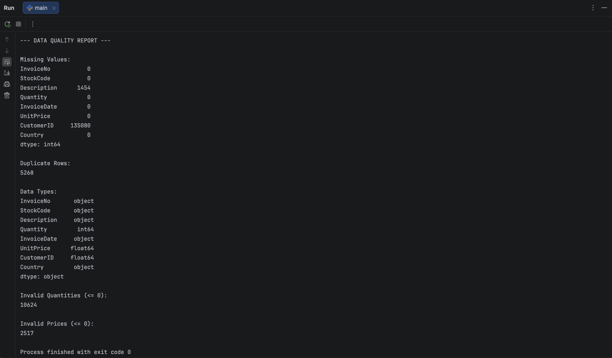

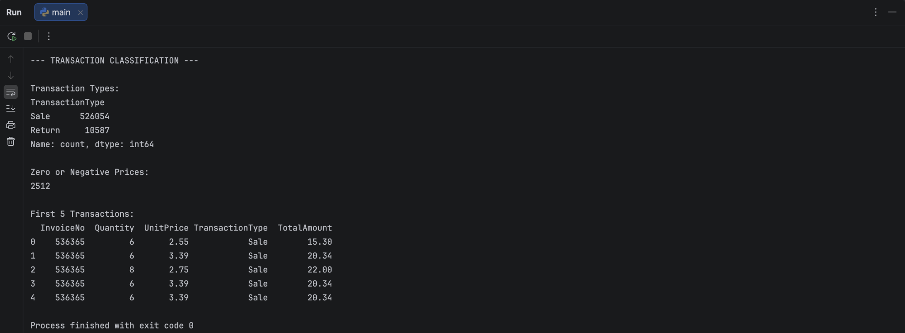

## 5. Final Data Validation

The transformed dataset was checked before database loading.

Validation covered record counts, duplicates, missing values, date conversions, and transaction amounts.

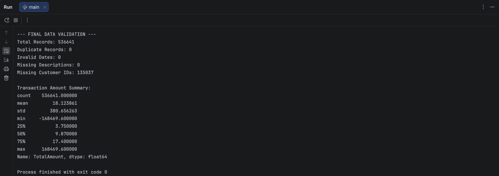

## 6. PostgreSQL Database Loading

The Python application connects to PostgreSQL through SQLAlchemy and Psycopg.

Database credentials are managed through environment variables rather than hardcoded into the Python source code.

The transformed dataset is loaded into the `retail_transactions` table.

**Load result: 536,641 records successfully loaded.**

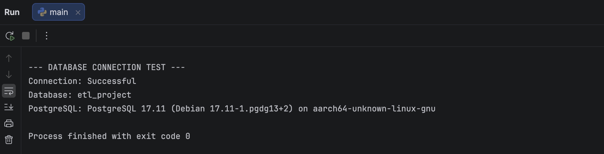

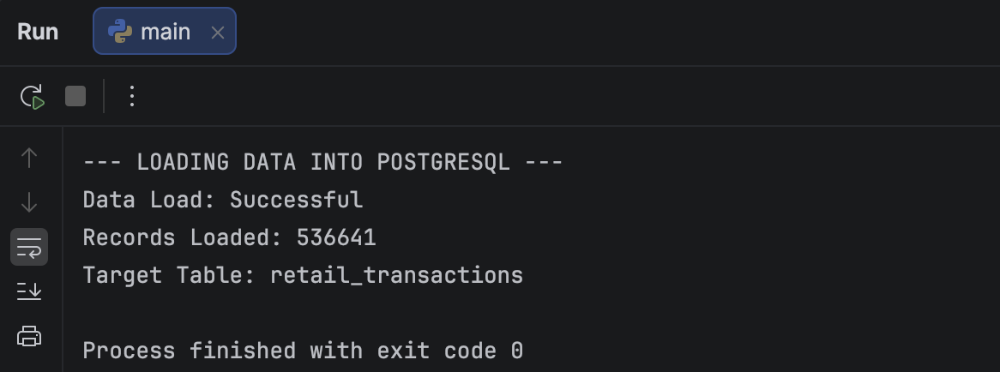

## 7. SQL Database Validation

After loading, SQL queries were executed in pgAdmin to confirm the records were stored successfully.

### Record Count Validation

```sql
SELECT COUNT(*) AS total_records
FROM retail_transactions;
```

**Result:** 536,641 records.

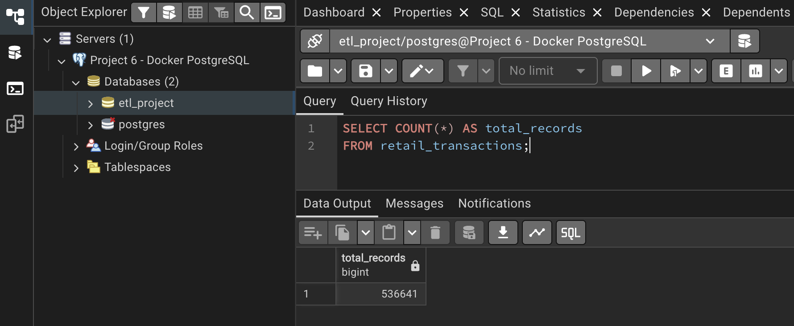

### Data Quality Validation

```sql
SELECT
    COUNT(*) AS total_records,
    COUNT(*) FILTER (
        WHERE "InvoiceDate" IS NULL
    ) AS invalid_dates,
    COUNT(*) FILTER (
        WHERE "Description" IS NULL
    ) AS missing_descriptions,
    COUNT(*) FILTER (
        WHERE "CustomerID" IS NULL
    ) AS missing_customer_ids,
    COUNT(*) FILTER (
        WHERE "TransactionType" = 'Sale'
    ) AS sales,
    COUNT(*) FILTER (
        WHERE "TransactionType" = 'Return'
    ) AS returns
FROM retail_transactions;
```

The SQL results were compared with the Python validation output to verify consistency.

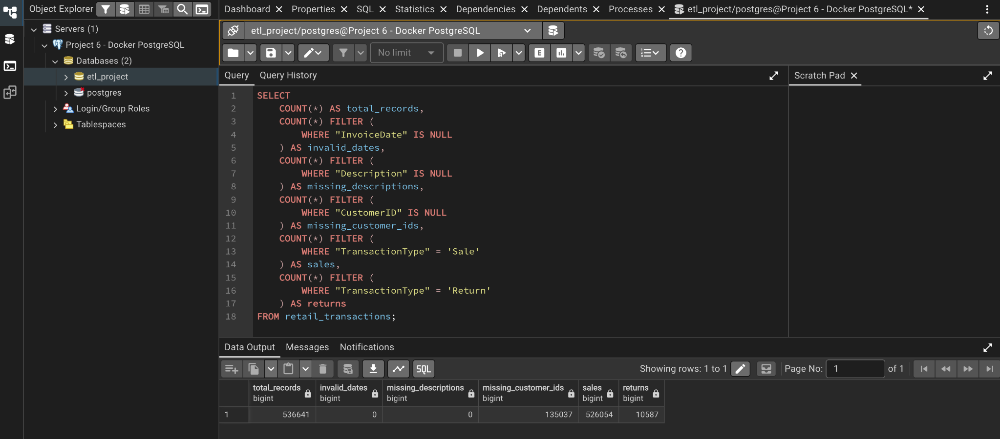

## 8. ETL Execution and Logging

The `run_etl.sh` script executes the Python pipeline and writes its output to `logs/etl.log`.

Execution logs provide visibility into data validation, database connectivity, and loading results.

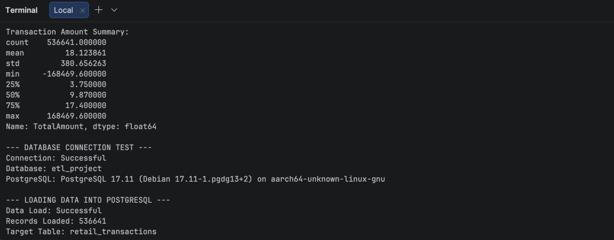

## 9. Scheduled Automation

The pipeline uses macOS `launchd` with the configuration file `com.portfolio.etl.plist`.

The schedule is configured for **9:00 AM daily** while the Mac is available to execute the scheduled job.

A manual scheduler test was performed successfully, returning exit code `0`.

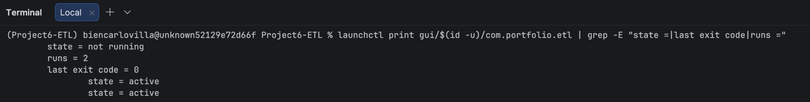

## 10. Running the Project

### Prerequisites

- Python with the required packages installed
- Docker Desktop
- PostgreSQL 17 Docker image
- A local PostgreSQL database
- The Online Retail CSV dataset

### Setup

1. Start the PostgreSQL Docker container and create the `etl_project` database.
2. Install Python dependencies using `pip install -r requirements.txt`.
3. Create a local `.env` file containing the database connection settings expected by `main.py`.
4. Place the dataset in the `data/` directory.
5. Run the pipeline:

```bash
python main.py
```

Alternatively, execute the shell script:

```bash
./run_etl.sh
```

The `launchd` scheduling configuration is intended for macOS. Other operating systems require a different scheduler.

**Security:** Database credentials, virtual environments, and execution logs are excluded from version control.

## Project Results

The project demonstrates practical experience with:

- ETL pipeline development
- Python-based data cleaning and validation
- PostgreSQL database administration and data loading
- Docker container management
- SQL data quality verification
- Environment-based credential management
- Shell scripting and scheduled execution
- Technical documentation and reproducible workflows

**Final outcome:** A functional Python ETL pipeline that processed and loaded 536,641 retail transaction records into Docker-hosted PostgreSQL, with a successfully tested scheduled execution.